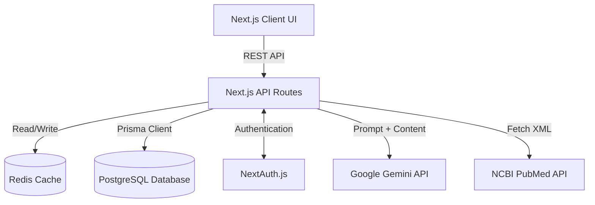
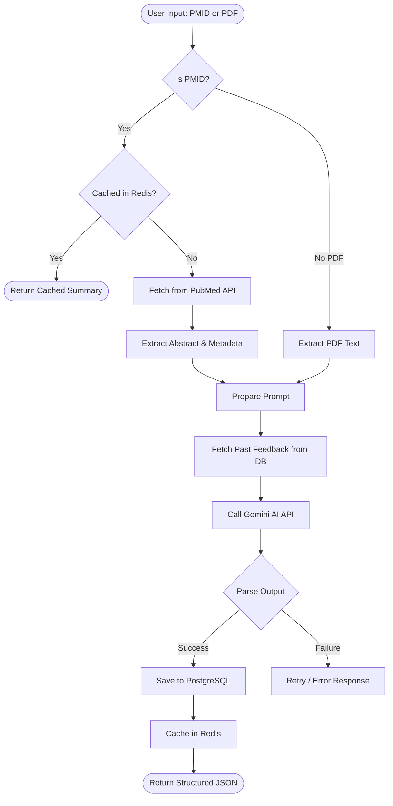
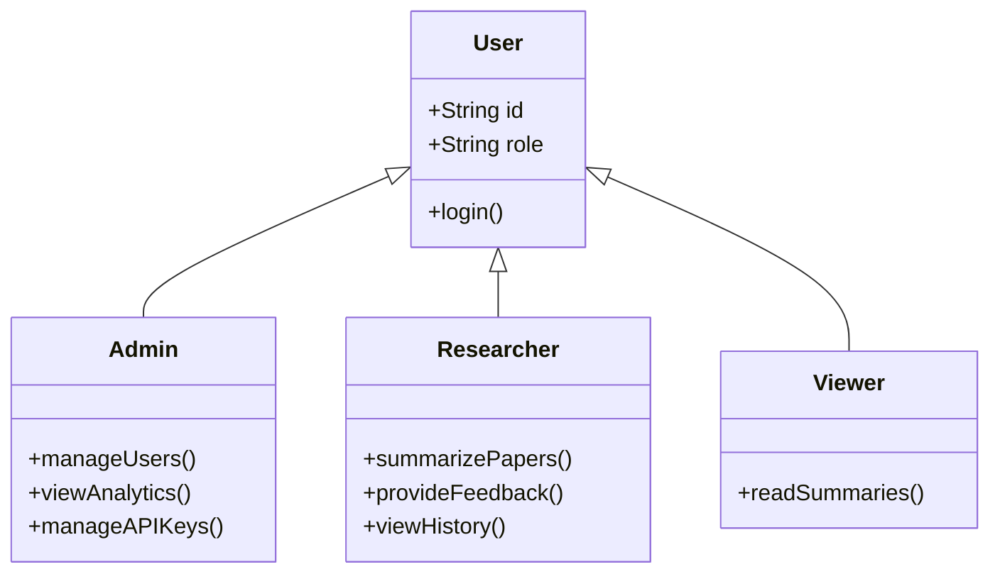

# 🏛️ System Architecture

## Papero — AI-Powered Research Summarization Platform

This document describes the overall system architecture, technology stack, folder structure, data flow, and key design decisions for the **Papero (DistillAI)** application.

---

## 1. High-Level Architecture

Papero follows a modern **serverless architecture** using Next.js API routes, a Neon PostgreSQL database, Upstash Redis, and the Google Gemini API.



- **Client** — Next.js App Router UI (landing page, auth pages, dashboard, admin panel).
- **API Routes** — serverless REST endpoints under `src/app/api` (all business logic).
- **PostgreSQL (Neon)** — source of truth via Prisma ORM.
- **Redis (Upstash)** — caches summaries for high-throughput reads.
- **Gemini API** — the summarization engine.
- **PubMed API** — fetches paper metadata/abstract by PMID.

---

## 2. Technology Stack

Technologies used in the project and their purpose:

| Layer            | Technology                        | Purpose                                    |
| ---------------- | --------------------------------- | ------------------------------------------ |
| Frontend         | Next.js 16 (App Router)           | UI framework & routing                     |
| Language         | TypeScript                        | Type safety & better developer experience  |
| Styling          | Tailwind CSS                      | Doodle design system (see DESIGN.md)       |
| Backend          | Next.js API Routes                | REST API & server logic (serverless)       |
| Database         | PostgreSQL (Neon) + Prisma ORM    | Data persistence & type-safe queries       |
| Authentication   | NextAuth (Credentials + JWT)      | Sessions & role-based access control       |
| AI               | Google Gemini API                 | Paper summarization engine                 |
| Cache            | Redis (Upstash, `ioredis`)        | Fast caching under high load               |
| PDF Parsing      | `pdf2json`                        | Full-text extraction from uploaded PDFs    |
| Validation       | Zod                               | Request/response validation                |
| Passwords        | `bcryptjs`                        | Secure password hashing                    |
| Deployment       | Vercel                            | Hosting & CI/CD                            |
| Version Control  | Git + GitHub                      | Source code management                     |

---

## 3. Folder Structure

The project follows a route + component based structure to keep the code organized and scalable.

```
papero/
├── docs/                     # Project documentation (PRD, ARCHITECTURE, RULES, DESIGN, TASKS, MEMORY)
├── prisma/                   # Prisma schema, migrations & seed script
├── postman/                  # Postman collection for API testing
├── src/
│   ├── app/                  # Next.js App Router (pages, layouts, API routes)
│   │   ├── page.tsx          #   Landing page (hero, how it works, output)
│   │   ├── login/            #   Login page
│   │   ├── register/         #   Registration page
│   │   ├── docs/             #   In-app API documentation page
│   │   ├── dashboard/        #   Researcher dashboard
│   │   │   ├── summarize/    #     Submit PubMed ID / PDF
│   │   │   ├── summaries/    #     Research library
│   │   │   ├── api-keys/     #     API key management
│   │   │   ├── feedback/     #     Rate summaries
│   │   │   ├── settings/     #     Profile settings
│   │   │   └── admin/        #     Admin panel (users, keys, analytics, audit)
│   │   └── api/              #   REST API route handlers
│   │       ├── auth/         #     NextAuth endpoints
│   │       ├── summarize/    #     Core summarization endpoint
│   │       ├── summaries/    #     Summary CRUD
│   │       ├── keys/         #     API key management
│   │       ├── feedback/     #     Feedback collection
│   │       └── admin/        #     Admin endpoints (users, analytics, stats)
│   ├── components/           # Shared UI components
│   │   ├── ui/               #   DoodleButton, DoodleCard, DoodleInput, DoodleTag
│   │   ├── illustrations/    #   Hand-drawn SVG illustration system
│   │   └── *.tsx             #   Navbar, Footer, Sidebars, EmptyState, Loader…
│   └── lib/                  # Shared server/client utilities
│       ├── prisma.ts         #   Prisma client singleton
│       ├── redis.ts          #   Redis client singleton
│       └── fetchWithAuth.ts  #   Authenticated fetch helper
├── tailwind.config.ts        # Design tokens (colors, fonts)
└── package.json
```

---

## 4. Data Model (Prisma)

| Model      | Purpose                                                            |
| ---------- | ------------------------------------------------------------------ |
| `User`     | Account, role (`ADMIN`/`RESEARCHER`/`VIEWER`), API usage counters  |
| `ApiKey`   | Named API keys with tier, usage count, limit, last-used tracking   |
| `Paper`    | Source paper (PubMed / PDF / Manual) with authors, abstract, DOI   |
| `Summary`  | AI output: key findings, methodology, conclusions, limitations…    |
| `Feedback` | Ratings (accuracy / coherence / overall) + comments per summary    |
| `AuditLog` | Who did what, when, from where (security & analytics)              |

```
User 1─n ApiKey        User 1─n Summary        User 1─n Feedback
Paper 1─n Summary      Summary 1─n Feedback    User 1─n AuditLog
```

---

## 5. Summarization Workflow

When a user submits a paper, the system processes it efficiently using caching to ensure high scalability and performance.



---

## 6. Role-Based Access Control (RBAC)

Robust security prevents unauthorized usage and controls feature access based on clear user roles.



| Route group          | VIEWER | RESEARCHER | ADMIN |
| -------------------- | :----: | :--------: | :---: |
| `/dashboard` overview|   ✅   |     ✅     |  ✅   |
| Summarize / Library  |   ❌   |     ✅     |  ✅   |
| API keys & feedback  |   ❌   |     ✅     |  ✅   |
| `/dashboard/admin/*` |   ❌   |     ❌     |  ✅   |

---

## 7. Key Design Decisions

| # | Decision | Rationale |
| - | -------- | --------- |
| 1 | **JWT sessions (no PrismaAdapter)** | Credentials provider + JWT keeps auth stateless; adapter removal fixed a 401 issue (see MEMORY.md) |
| 2 | **Serverless API routes** | Zero server management; scales automatically on Vercel |
| 3 | **Redis cache-first reads** | Same paper summarized once; repeat requests are ~free |
| 4 | **Feedback-aware prompting** | Past user feedback is injected into prompts so summaries improve over time |
| 5 | **Centralized client singletons** | `lib/prisma.ts` & `lib/redis.ts` avoid connection exhaustion in serverless |
| 6 | **Usage counters on User + ApiKey** | Enforce `apiCallsLimit` at two levels without a billing provider |
